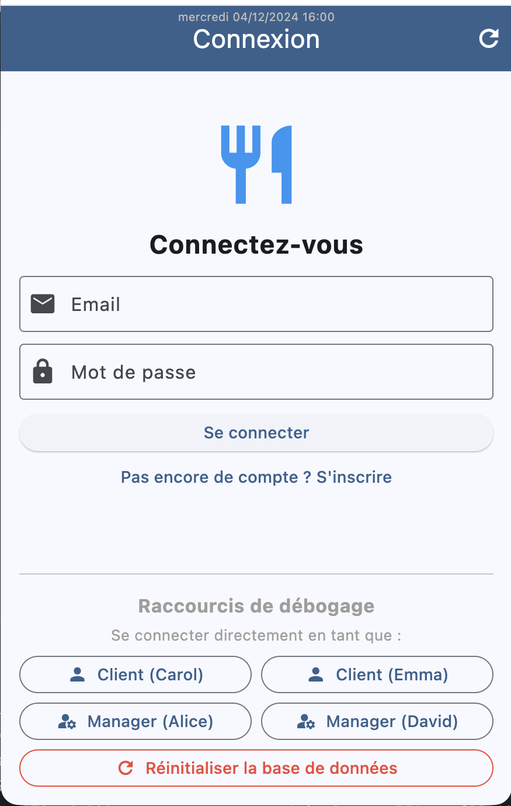
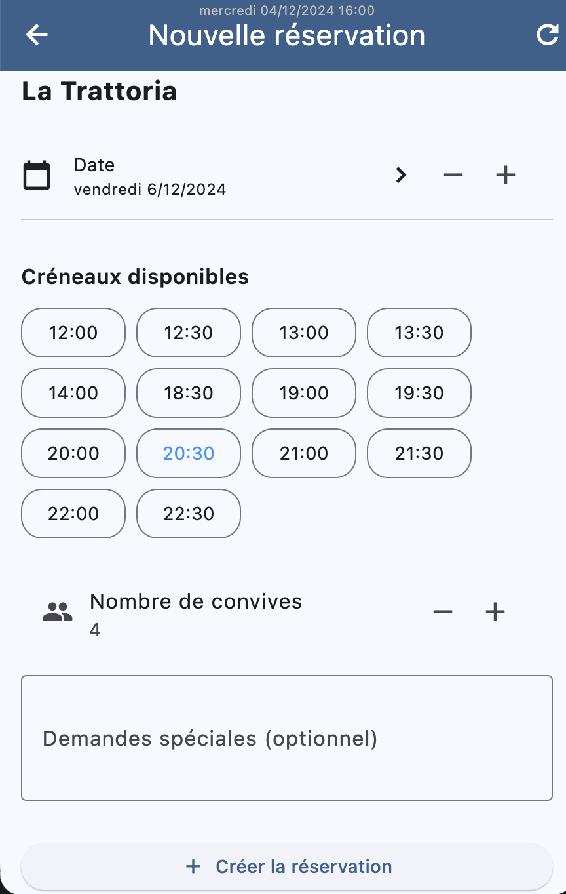
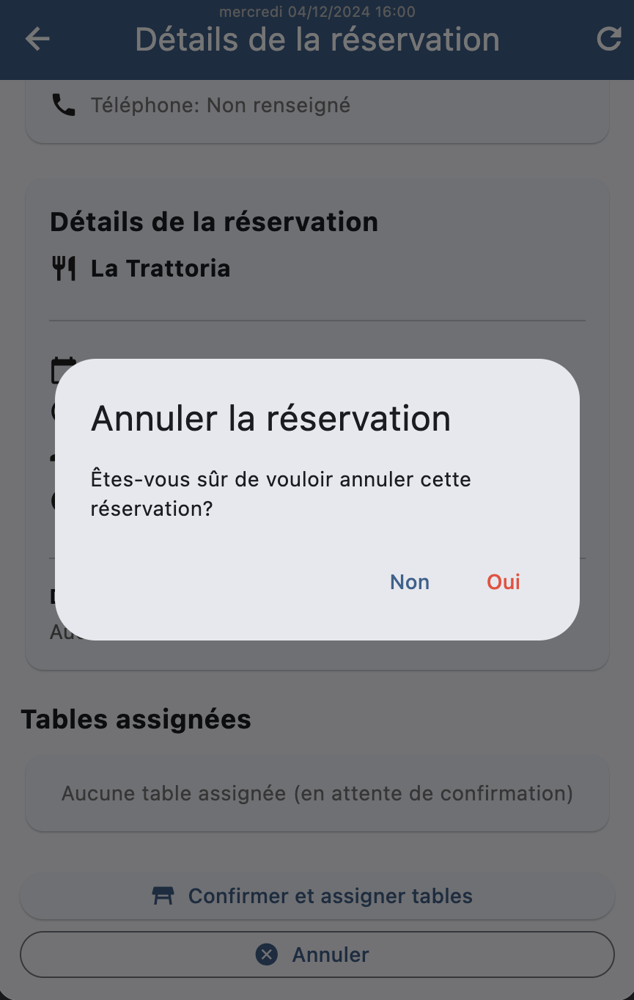

# ReserVite

A restaurant reservation app I made with [Bilal El Azzouzi](https://github.com/eab98) for a school project at EPFC (2025-2026).

Customers can look for a restaurant and book a table. Managers can confirm the bookings, assign tables and manage their restaurant.

The app is made with Flutter and Riverpod. The backend is a PostgreSQL database exposed with PostgREST: the app only calls SQL functions, never the tables directly. Most of the business rules (reservation status, time slots, table capacity, double bookings...) are checked in the database with triggers.

## Screenshots

  
  
  

## What I did

In the database:

- the rules on single tables (tables, reservations)
- 8 of the 14 numbered business rules (BR-04, 05, 06, 08, 09, 10, 11, 14), with triggers

In the app, each feature from end to end (SQL function, API call, model, Riverpod provider and view):
- sign up, login, reset of the database
- the simulated time, to test the rules that depend on the date
- for customers: list, view, add, edit and cancel a reservation
- for managers: cancel and complete a reservation, manage tables, sort the restaurants by latest reservation

After a change, the providers update the data locally instead of reloading everything from the server, so every screen showing that data refreshes on its own.

## How to run it

You need PostgreSQL, PostgREST and Flutter installed.

1. Start the database and PostgREST:
   `bash scripts/postgrest-start.sh`
2. Run the SQL files of `backend/scripts` in order on the database `prbd-2526-a03`.
3. Start the app:
   `cd frontend`
   `flutter pub get`
   `flutter run -d chrome`

Test accounts (password `Password1,`): `client@example.com` and `manager@example.com`.

All demo users and data are fictional.
